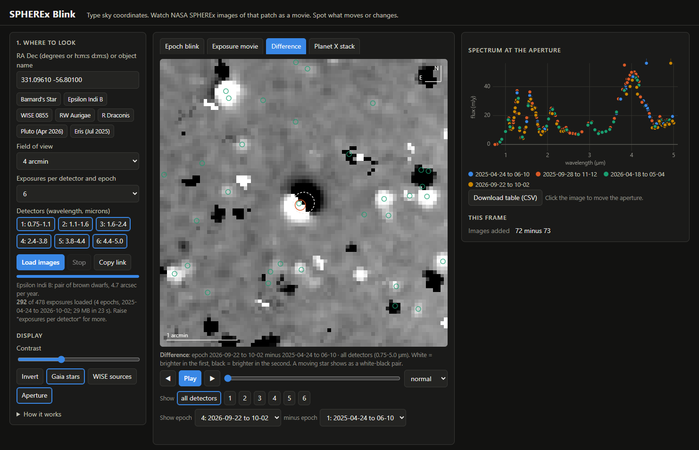

# SPHEREx Blink

**Type sky coordinates. Watch NASA SPHEREx images of that patch as a movie. Spot what moves or changes — up to a search for Planet X.**

NASA Space Apps Challenge 2026 · challenge: **Planet X and SPHEREx** · Baku local event

- Live tool: `https://<your-user>.github.io/<your-repo>/` (see [Publish it](#publish-it-github-pages))
- The tool is a static web page. It has no server and no API keys.



## What it does

| Challenge asks for | In the tool |
|---|---|
| Enter RA and Dec, see a series of images "like a little video" | Coordinates in degrees or h:m:s, or an object name. **Epoch blink** plays one deep image per SPHEREx visit; **Exposure movie** plays every single exposure. |
| Easy to update with new data releases | `python tools/build_index.py` re-reads the public bucket and adds new exposures. Finished periods are cached. |
| Use the 102 bands; add the data of each of the six detectors; spectra on the fly | Buttons 1–6 add the exposures of one detector. Click any point: its **102-channel spectrum** is measured from the loaded exposures, one colour per epoch, downloadable as CSV. |
| Add or subtract images taken at different times | **Difference** view: one epoch minus another. Fixed stars cancel; a moving star shows as a white-black pair. |
| Let users choose the field of view | 2 to 16 arcmin. |
| Overlay Gaia or WISE | Gaia DR3 stars (moved to the date of each frame with their proper motion) and CatWISE2020 sources. |
| Coordinates in the URL | `?ra=133.7951&dec=-7.2451&fov=6&depth=6&view=epochs&det=6` reopens any view; "Copy link" gives it. |
| Show metadata | Per-exposure panel: observation id, release, time, detector, wavelength, exposure time, sky level, noise, link to the FITS file. |
| "…even new planets reveal themselves by shifting position" | **Planet X stack**: removes the fixed sky and shift-and-stacks one visit along the track of a body at a chosen distance from the Sun. It can scan all distances and inject a test planet. |

## Tested on the challenge targets

Screenshots are in [`figures/`](figures/): Barnard's Star, Epsilon Indi B, WISE 0855, Pluto, Eris and the Planet 9 zone (the Epsilon Indi B and WISE 0855 ones come from an earlier build of the same day). `bash tools/make_figures.sh` re-captures all presets.

| Target | What the tool shows |
|---|---|
| **Barnard's Star** | Difference of the 2026 and 2025 epochs gives a clear north-south white-black pair: the star moved north, as its 10.4 arcsec/yr proper motion predicts. The star saturates below 3.8 µm; at 4–5 µm the spectrum reads 2–4 Jy. |
| **Epsilon Indi B** | The brown-dwarf pair moves south-east between epochs. The spectrum (20–45 mJy) shows the peaks near 1.3, 1.6, 2.1 and 4.1 µm and the deep methane and water absorption between them, the same in all four epochs. |
| **WISE 0855** | Too faint for single exposures. At its predicted position the spectrum has a 4.4–5 µm excess of about 0.5 mJy, which matches its known brightness (W2 = 13.9 mag). At this date it is blended with a background star that dominates below 3 µm. |
| **RW Aurigae**, **R Draconis** | Both open as presets from pre-downloaded cutouts (333 and 354 exposures). The spectrum panel colours each epoch separately, so brightness changes between visits can be compared. **Not yet inspected by us**: open both once and record what they show before quoting a result. |

## Planet X: what the stack can and cannot do

Validation on bodies whose position is known (ephemeris from JPL Horizons through IRSA's moving-object search):

| Test | Result |
|---|---|
| **Pluto**, April 2026 visit (98 exposures) | Found at 449 σ. Best-fit distance **36 AU** (true 35.5 AU). Position 1 arcsec from the ephemeris. |
| **Eris**, July 2025 visit (112 exposures; V = 18.7, 96 AU) | Found at **13 σ**, 2 arcsec from the ephemeris. It is hard to see in any single exposure. Its best-fit circular-orbit distance is 144 AU: Eris is near the far end of an eccentric orbit and moves slower than a circular orbit would. |
| Same fields, epochs without the body | Brightest point 5–8 σ. We therefore treat only peaks of **9 σ or more** as signals. |
| Injected test planets, Taurus field (RA 60°, Dec +20°), detectors 1–2, one visit, 36 exposures | 200 µJy (AB 18.2): recovered at 21–23 σ. 100 µJy (AB 18.9): recovered at 10.4 σ. 60 µJy (AB 19.5): not recovered. |

So one visit reaches about **AB 19.0** (about 90 µJy at 0.75–1.6 µm). In that pilot field no signal above 9 σ was found.

Where the numbers come from: the Pluto and Eris rows are the printed output of `node tools/planetx.mjs pack pluto` and `... pack eris`; the injection rows are also saved in `results/planetx.jsonl`. Re-run the two commands to append the Pluto and Eris rows to that file.

What this means for Planet Nine (Brown & Batygin 2021; Brown, Holman & Batygin 2024): the models that optical surveys have not yet excluded have V ≈ 22 at about 550 AU, which is 2–3 magnitudes fainter than one SPHEREx visit reaches. With the data public today the tool can find a Neptune-size, highly reflective planet out to roughly 480 AU, and smaller, nearer bodies such as Eris. **We claim no discovery.** The tool makes the search possible for anyone, and the limit improves as SPHEREx repeats its survey.

Known limits of the method:

- The stack assumes a circular orbit. Beyond about 300 AU a body barely moves within one visit, so its distance has to come from finding it again in another epoch; the tool lists where to look.
- A bright body passing through the field (Pluto) can leave a faint trace in the stacks of visits with few exposures.
- The pixel-flag layer of the SPHEREx files is compressed and cannot be read piece by piece from a browser. The tool rejects dead and hot pixels itself and uses a trimmed mean when adding exposures.
- Fluxes are aperture photometry (9 arcsec radius) without aperture correction; treat them as good to about 10–20 %.

## How it works

```
tools/build_index.py ──► docs/index/  (4,584 small JSON files: 1,628,230 images, where each one points)
                                │
browser ── RA, Dec ────────────►│ which exposures cover this point?
        ── HTTP range requests ─────────► NASA SPHEREx bucket on Amazon S3
             35 kB header (pointing)       s3://nasa-irsa-spherex  (public, CORS enabled)
             + only the detector rows needed (0.4–1 MB instead of 65 MB per image)
        ── resample north-up, subtract sky, stack, difference, photometry, shift-and-stack
```

- **No server.** IRSA's search services cannot be called from a web page (no CORS) and were overloaded during the hackathon. The tool needs only the S3 bucket and its own static index.
- **Index.** One 1 kB header slice per exposure gives the pointing of detector 1; the other five detectors follow from the fixed focal-plane geometry (measured to 0.006°). The page confirms every hit with the real header.
- **Astrometry.** TAN projection with SIP distortion, written in JavaScript and checked against astropy: positions agree to 10⁻⁹ pixel, wavelengths to 5×10⁻⁷ µm (`node tests/test_core.mjs`). Gaia stars land on the SPHEREx stars.
- **Wavelength.** SPHEREx filters change colour across each detector, so every exposure sees a different wavelength at a given sky point. The page reads it from the mission's lookup table (`docs/wave.json`).
- **Planet X stack.** Fixed sky = per-pixel median of all exposures of a detector, bright stars masked. Track = parallax from the Earth's orbit plus a circular orbit at the trial distance and tilt. Exposures are shifted along the track and added with a trimmed mean; the result is a signal-to-noise map.
- **Packs.** The preset targets ship pre-downloaded cutouts (`docs/packs/`) so they open at once on a slow network. Any other position is downloaded live.

## Run it

```bash
python -m http.server 8765 --directory docs      # then open http://127.0.0.1:8765
node tests/test_core.mjs                          # self-check against astropy values
node tests/fetch_demo.mjs 133.795129 -7.245147    # network smoke test
```

Rebuild or extend the data (Python 3.11+, `pip install -r requirements.txt`; Node 18+):

```bash
python tools/build_index.py                # sky index from the S3 bucket (about 30 min the first time, then incremental)
python tools/make_wave_table.py            # wavelength tables
node tools/make_packs.mjs                  # pre-downloaded cutouts for the presets
node tools/planetx.mjs pack eris           # Planet X scan of a pack; add --inject 100 500 for an injection test
node tools/planetx.mjs field 60 20 --fov 10 --dets 12 --save my-field    # download and scan any field
bash tools/make_figures.sh                 # screenshots in figures/
```

## Publish it (GitHub Pages)

1. Create a public GitHub repository and push this folder.
2. Repository **Settings → Pages → Build and deployment → Deploy from a branch → `main`, folder `/docs`**.
3. The tool is then at `https://<your-user>.github.io/<your-repo>/`. Open it in a private window to check that it needs no login.

The `docs/` folder is 154 MB (index 70 MB, packs 84 MB); the largest file is 15 MB, below GitHub's 100 MB limit.

## Repository layout

| Path | Content |
|---|---|
| `docs/` | The web tool: `index.html`, `app.js` (interface), `core.js` (FITS, astrometry, stacking, photometry), `presets.js`, `wave.json`, `index/`, `packs/` |
| `tools/` | `build_index.py`, `make_wave_table.py`, `make_packs.mjs`, `planetx.mjs`, `shot.mjs`, `make_figures.sh` |
| `tests/` | `test_core.mjs` (offline self-check), `fetch_demo.mjs` (network smoke test), fixtures |
| `results/planetx.jsonl` | Saved output of the command-line Planet X runs (currently the five injection tests) |
| `figures/` | Screenshots of the tool: Barnard's Star, Epsilon Indi B, WISE 0855, Pluto, Eris, Planet 9 zone |
| `SUBMISSION.md` | English texts for the Space Apps project page |

## Data sources and licences

| Source | Used for | Terms | Reference |
|---|---|---|---|
| **NASA SPHEREx Level-2 spectral images**, releases DR1 and QR3 (NASA/IPAC Infrared Science Archive; public bucket `s3://nasa-irsa-spherex`) | Every image the tool shows | U.S. Government work; NASA asks to be acknowledged as the source | DOI 10.26131/IRSA678 (DR1), 10.26131/IRSA662 (QR3); https://irsa.ipac.caltech.edu/Missions/spherex.html |
| **NASA/IPAC IRSA** Moving Object Search Tool and **JPL Horizons** | Ephemeris positions of Pluto and Eris for the validation presets | NASA/JPL services | https://irsa.ipac.caltech.edu/applications/MOST/ ; https://ssd.jpl.nasa.gov/horizons/ ; data.nasa.gov entries `nasa-ipac-infrared-science-archive`, `horizons` |
| **CatWISE2020** (NASA WISE/NEOWISE) through CDS VizieR | "WISE sources" overlay | U.S. Government work | DOI 10.26131/IRSA551; https://data.nasa.gov/dataset/catwise2020-catalog |
| **Gaia DR3** (ESA) through CDS VizieR | "Gaia stars" overlay with proper motions | CC BY-NC 3.0 IGO | https://www.cosmos.esa.int/web/gaia-users/license |
| **CDS Sesame / SIMBAD** | Object-name lookup | Free for scientific use, with acknowledgement | https://cds.unistra.fr/ |
| Brown & Batygin 2021 (AJ 162, 219); Brown, Holman & Batygin 2024 (AJ 167, 146) | Planet Nine brightness and distance quoted above | Published papers | arXiv:2108.09868, arXiv:2401.17977 |
| astropy, numpy, requests | Index builder and test values | BSD-3-Clause / Apache-2.0 | https://www.astropy.org |

Acknowledgements required by the data providers:

> This publication makes use of data products from the Spectro-Photometer for the History of the Universe, Epoch of Reionization and Ices Explorer (SPHEREx), which is a joint project of the Jet Propulsion Laboratory and the California Institute of Technology, and is funded by the National Aeronautics and Space Administration.

> This research has made use of the NASA/IPAC Infrared Science Archive, which is funded by the National Aeronautics and Space Administration and operated by the California Institute of Technology.

> This work has made use of data from the European Space Agency (ESA) mission Gaia (https://www.cosmos.esa.int/gaia), processed by the Gaia Data Processing and Analysis Consortium (DPAC). Funding for the DPAC has been provided by national institutions, in particular the institutions participating in the Gaia Multilateral Agreement.

> This publication makes use of data products from the Wide-field Infrared Survey Explorer and NEOWISE, which are joint projects of the University of California, Los Angeles, and the Jet Propulsion Laboratory/California Institute of Technology, funded by the National Aeronautics and Space Administration.

This project is not affiliated with or endorsed by NASA. It uses no NASA logos.

## Use of AI

An AI coding assistant (Claude by Anthropic, used through Claude Code) wrote most of the code and documentation in this repository, researched how to access the data, and ran the tests, working from the team's direction. Source files say so in their header. All numbers and figures come from running that code on real NASA data: the figures are screenshots of the tool, and no image, video or audio was generated by AI.

## Licence

Code: MIT (see `LICENSE`). Data keep the terms listed above.
